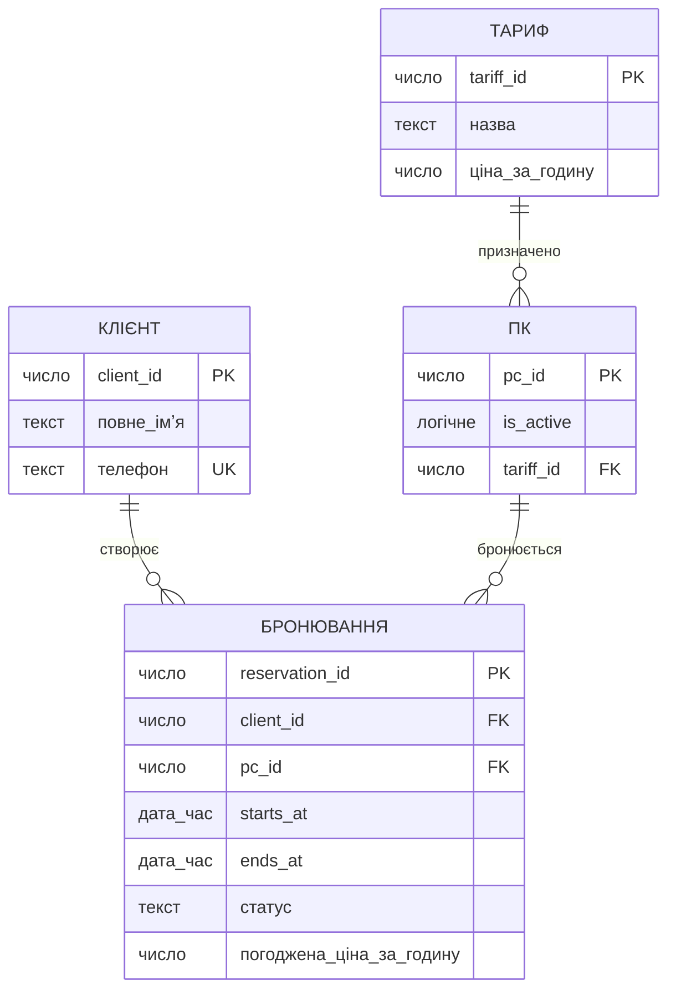
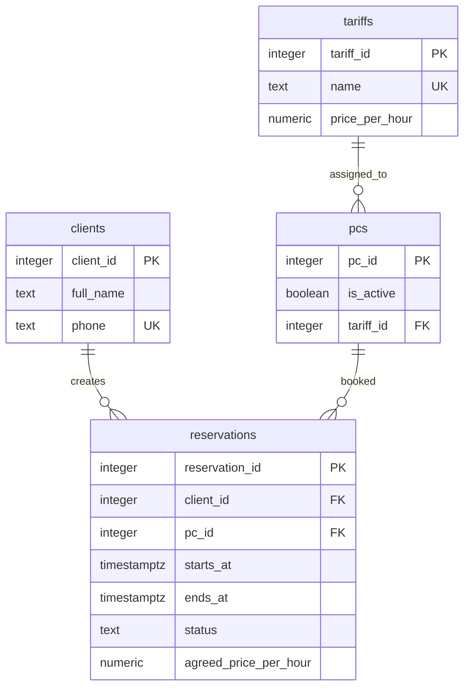

# Лабораторна робота №1. Моделювання предметної області та створення схеми бази даних

Виконавець: **вкажіть прізвище та імʼя, групу**.

Предметна область: **кіберклуб з попереднім бронюванням компʼютерів**.

## 1. Предметна область

Кіберклуб надає клієнтам компʼютерні місця для гри за погодинними тарифами. Кожне місце має номер і тариф, що відповідає характеристикам компʼютера. Клієнт бронює конкретне місце на визначений проміжок часу; система не дозволяє накладати активні бронювання одного місця. Під час створення бронювання погодинна ціна тарифу фіксується, а завершення бронювання визначається за часом його закінчення.

## 2. Бізнес-правила

| № | Правило | Де перевіряється | Обмеження або обґрунтування |
|---|---|---|---|
| 1 | Кожен клієнт має окремий ідентифікатор; номер телефону унікальний | схема | `PRIMARY KEY`, `UNIQUE`, `NOT NULL` |
| 2 | `pc_id` є номером місця та має бути додатним | схема | `PRIMARY KEY`, `CHECK (pc_id > 0)` |
| 3 | Кожен ПК має один призначений тариф, який існує | схема | `NOT NULL`, `FOREIGN KEY` |
| 4 | Назва тарифу унікальна і не порожня | схема | `UNIQUE`, `CHECK` |
| 5 | Ціна тарифу та зафіксована ціна бронювання не можуть бути відʼємними; нуль дозволений | схема | `CHECK (price >= 0)` |
| 6 | Бронювання належить одному наявному клієнту й одному наявному ПК | схема | `NOT NULL`, `FOREIGN KEY` |
| 7 | Час закінчення бронювання має бути пізніше часу початку | схема | `CHECK (ends_at > starts_at)` |
| 8 | Активні бронювання одного ПК не перетинаються; скасовані не займають час | схема | обмеження `EXCLUDE` для часових інтервалів |
| 9 | Дозволені сусідні бронювання, якщо одне закінчується рівно тоді, коли починається наступне | схема | інтервал напіввідкритий: `[початок, кінець)` |
| 10 | Неактивний ПК не можна забронювати | схема | тригер перевіряє `pcs.is_active` |
| 11 | Ціна бронювання автоматично копіюється з тарифу ПК і зберігається при подальшій зміні тарифу | схема | тригер встановлює історичну `agreed_price_per_hour` |
| 12 | Статуси бронювання — `active` або `cancelled`; завершення визначається за `ends_at` | схема та запит | `CHECK`; окремий статус «завершена» не зберігається |

## 3. ER-модель



### Сутності

- **Тариф** — назва тарифу та його поточна ціна за годину.
- **ПК** — компʼютерне місце клубу; `pc_id` одночасно є номером місця.
- **Клієнт** — людина, яка бронює місце; телефон є унікальним контактним номером.
- **Бронювання** — резервування одного ПК для одного клієнта на часовий інтервал.

### Звʼязки

- Один тариф може бути призначений нулю або багатьом ПК; кожен ПК має рівно один тариф (1:N).
- Один клієнт може створити нуль або багато бронювань; кожне бронювання належить одному клієнту (1:N).
- Один ПК може мати багато бронювань у різний час; кожне бронювання стосується одного ПК (1:N). Часові інтервали активних бронювань не перетинаються.
- Тариф бронювання визначається через призначений ПК. Погоджена ціна копіюється в бронювання як історичне значення.

### Перевірка за типовими помилками

- [x] Атрибут, який насправді є сутністю: тариф винесено в окрему сутність.
- [x] Звʼязок без кардинальності: усі звʼязки мають кардинальності.
- [x] Одна широка таблиця замість кількох сутностей: клієнти, ПК, тарифи та бронювання розділено.
- [x] Телефон або електронна пошта як первинний ключ: клієнт має окремий `client_id`; телефон — унікальний альтернативний ключ.

Результат перевірки: окрему сутність тарифу та звʼязки 1:N враховано; телефон не використовується як первинний ключ.

## 4. Ключі та реакції на видалення

### Первинні ключі

| Сутність | Потенційні ключі | Первинний ключ | Обґрунтування |
|---|---|---|---|
| Клієнт | `client_id`, унікальний `phone` | `client_id` | Сурогатний ключ не залежить від зміни контактного номера |
| ПК | номер місця `pc_id` | `pc_id` | За погодженим правилом ID ПК і є номером місця |
| Тариф | `tariff_id`, унікальна назва | `tariff_id` | Назву тарифу можна перейменувати |
| Бронювання | `reservation_id` | `reservation_id` | Сурогатний ключ стабільно ідентифікує історичний запис |

### Реакції на видалення

| Звʼязок | Реакція | Обґрунтування з погляду бізнесу |
|---|---|---|
| Клієнт — Бронювання | `RESTRICT` | Не видаляти клієнта, якщо його бронювання потрібні в історії |
| ПК — Бронювання | `RESTRICT` | Не видаляти місце з історією; нові броні можна заборонити через `is_active = false` |
| Тариф — ПК | `RESTRICT` | Не видаляти тариф, призначений компʼютеру |

## 5. Нормалізація

### Функціональні залежності

1. `client_id → full_name, phone`; через унікальність також `phone → client_id, full_name`.
2. `tariff_id → name, price_per_hour`; через унікальність також `name → tariff_id, price_per_hour`.
3. `pc_id → tariff_id, is_active`.
4. `reservation_id → client_id, pc_id, starts_at, ends_at, status, agreed_price_per_hour`.

### «Погана» таблиця

Один рядок відповідає одному бронюванню, але дані клієнта, ПК і тарифу повторюються.

| reservation_id | client_id | full_name | phone | pc_id | is_active | tariff_id | tariff_name | поточна_ціна | starts_at | ends_at | status | погоджена_ціна |
|---:|---:|---|---|---:|---|---:|---|---:|---|---|---|---:|
| 101 | 1 | Олена Коваль | +380000000001 | 7 | true | 2 | Про | 220 | 2030-01-10 18:00 | 2030-01-10 20:00 | active | 200 |
| 102 | 1 | Олена Коваль | +380000000001 | 7 | true | 2 | Про | 220 | 2030-01-11 18:00 | 2030-01-11 19:00 | active | 200 |
| 103 | 2 | Андрій Мельник | +380000000002 | 3 | true | 1 | Нормал | 100 | 2030-01-11 18:00 | 2030-01-11 20:00 | active | 100 |

### Аномалії

- **Аномалія оновлення:** після зміни назви тарифу «Про» або його поточної ціни доведеться узгоджено оновити всі рядки; пропуск рядка залишить суперечливі дані. Погоджена ціна старого бронювання при цьому не повинна змінюватися.
- **Аномалія вставки:** новий тариф або ПК не можна внести без створення фіктивного бронювання.
- **Аномалія видалення:** видалення останнього бронювання клієнта може випадково стерти єдину копію його імені й телефону.

### Крок 1. 1NF

Отримана таблиця: один рядок на бронювання; кожен стовпець містить одне атомарне значення, повторюваних списків немає.

Знята проблема: значення атрибутів атомарні. Повторення даних клієнта, ПК і тарифу поки залишаються.

### Крок 2. 2NF

Отримана таблиця: структура після 1NF не змінюється, ключ `reservation_id` складається з одного стовпця.

Знята проблема: часткових залежностей від частини складеного ключа немає, тому що первинний ключ простий.

### Крок 3. 3NF

Отримані таблиці з ключами:

- `clients(client_id PK, full_name, phone UNIQUE)`;
- `tariffs(tariff_id PK, name UNIQUE, price_per_hour)`;
- `pcs(pc_id PK, tariff_id FK, is_active)`;
- `reservations(reservation_id PK, client_id FK, pc_id FK, starts_at, ends_at, status, agreed_price_per_hour)`.

Знята проблема: атрибути клієнта, ПК і тарифу зберігаються у своїх сутностях, а не залежать транзитивно від `reservation_id`.

### Звірка з ER-моделлю

Таблиці після 3NF відповідають сутностям ER-моделі. `agreed_price_per_hour` у бронюванні — навмисний історичний знімок погодженої ціни, а не поточна ціна тарифу.

### Денормалізація

Погоджена ціна тарифу копіюється в бронювання під час його створення. Це навмисне збереження історичного факту: майбутня зміна ціни тарифу не змінює вже створені бронювання. Значення встановлює тригер бази даних.

## 6. Реляційна схема



## 7. Середовище

Операційна система: Windows.

```powershell
docker compose up -d
docker compose ps
```

Фактичний стан PostgreSQL під час перевірки:

```text
NAME              IMAGE           SERVICE    STATUS
dbsa-postgres-1   postgres:18.6   postgres   Up
```

Підключення pgAdmin: сервер `localhost`, порт `5432`, база `dbsa`, користувач `student`.

Дані зберігаються в іменованому томі `pgdata`, підключеному до `/var/lib/postgresql`. `docker compose down` видаляє контейнер, але зберігає том; `docker compose down -v` також видаляє том і дані.

Перевірка збереження: в окремому тимчасовому контейнері створено тестовий рядок, контейнер пересоздано з тим самим томом — рядок залишився. Тимчасовий контейнер і його том після перевірки видалено.

## 8. Створення схеми

- Міграція 001: [migrations/001_create_schema.up.sql](migrations/001_create_schema.up.sql), [migrations/001_create_schema.down.sql](migrations/001_create_schema.down.sql)
- `reservations_no_active_overlap` — обмеження `EXCLUDE` за ПК і часовим інтервалом; скасовані бронювання не враховуються. Воно перевірене тестовим SQL, оскільки наданий скрипт `check-schema.sql` показує обмеження типів `PRIMARY KEY`, `UNIQUE`, `FOREIGN KEY` і `CHECK`.
- `set_reservation_price()` забороняє бронювання неактивного ПК і копіює ціну призначеного тарифу.
- Для індексації виключення використовується розширення PostgreSQL `btree_gist`. Міграція `down` прибирає таблиці й тригерну функцію, але залишає розширення, щоб не видаляти його, якщо воно використовується іншими обʼєктами бази.
- Запит [availability-query.sql](availability-query.sql) показує активні ПК, вільні у вказаний інтервал. Обмеження `EXCLUDE` повторно перевіряє зайнятість під час вставлення, навіть якщо два клієнти одночасно побачили місце в запиті.

Демонстрація: коли ПК `900001` зайнятий з 17:00 до 19:00, а запитано 18:00–20:00, запит повернув вільний ПК `900002`; його скасоване бронювання не блокує час.

## 9. Перевірка обмежень

Файл перевірок: [constraint-checks.sql](constraint-checks.sql). Скрипт запускається в транзакції та відкочує тестові дані.

| Правило | Обмеження | Повідомлення PostgreSQL |
|---|---|---|
| Імʼя клієнта обовʼязкове | `NOT NULL` | `null value in column "full_name" of relation "clients" violates not-null constraint` |
| Телефон унікальний | `UNIQUE` | `duplicate key value violates unique constraint "clients_phone_key"` |
| Ціна не відʼємна | `CHECK` | `new row for relation "tariffs" violates check constraint "tariffs_price_per_hour_check"` |
| Бронювання посилається на наявного клієнта | `FOREIGN KEY` | `insert or update on table "reservations" violates foreign key constraint "reservations_client_id_fkey"` |
| Номер ПК — первинний ключ | `PRIMARY KEY` | `duplicate key value violates unique constraint "pcs_pkey"` |
| Час бронювання не перетинається | `EXCLUDE` | `conflicting key value violates exclusion constraint "reservations_no_active_overlap"` |

Додатково перевірено: некоректний інтервал відхиляється; сусідні інтервали й бронювання скасованого часу дозволені; ціна старої броні не змінюється після зміни тарифу; неактивний ПК не можна забронювати.

## 10. Цикл up — down — up

Перевірку виконано в окремій базі `dbsa_check`, щоб не змінювати наявні таблиці бази `dbsa`.

Результат [check-schema.sql](check-schema.sql) після першого `up`:

```text
table_name    | kind         | name                                     | definition
--------------+--------------+------------------------------------------+------------------------------------------------------------------------------------------------------------------------
clients       | стовпець     | client_id                                | integer NOT NULL GENERATED AS IDENTITY
clients       | стовпець     | full_name                                | text NOT NULL
clients       | стовпець     | phone                                    | text NOT NULL
clients       | PRIMARY KEY  | clients_pkey                             | PRIMARY KEY (client_id)
clients       | UNIQUE       | clients_phone_key                        | UNIQUE (phone)
clients       | CHECK        | clients_full_name_check                  | CHECK ((btrim(full_name) <> ''::text))
clients       | CHECK        | clients_phone_check                      | CHECK ((btrim(phone) <> ''::text))
pcs           | стовпець     | pc_id                                    | integer NOT NULL
pcs           | стовпець     | is_active                                | boolean NOT NULL
pcs           | стовпець     | tariff_id                                | integer NOT NULL
pcs           | PRIMARY KEY  | pcs_pkey                                 | PRIMARY KEY (pc_id)
pcs           | FOREIGN KEY  | pcs_tariff_id_fkey                       | FOREIGN KEY (tariff_id) REFERENCES tariffs(tariff_id) ON DELETE RESTRICT
pcs           | CHECK        | pcs_pc_id_check                          | CHECK ((pc_id > 0))
reservations  | стовпець     | reservation_id                           | integer NOT NULL GENERATED AS IDENTITY
reservations  | стовпець     | client_id                                | integer NOT NULL
reservations  | стовпець     | pc_id                                    | integer NOT NULL
reservations  | стовпець     | starts_at                                | timestamp with time zone NOT NULL
reservations  | стовпець     | ends_at                                  | timestamp with time zone NOT NULL
reservations  | стовпець     | status                                   | text NOT NULL
reservations  | стовпець     | agreed_price_per_hour                    | numeric NOT NULL
reservations  | PRIMARY KEY  | reservations_pkey                        | PRIMARY KEY (reservation_id)
reservations  | FOREIGN KEY  | reservations_client_id_fkey              | FOREIGN KEY (client_id) REFERENCES clients(client_id) ON DELETE RESTRICT
reservations  | FOREIGN KEY  | reservations_pc_id_fkey                  | FOREIGN KEY (pc_id) REFERENCES pcs(pc_id) ON DELETE RESTRICT
reservations  | CHECK        | reservations_agreed_price_per_hour_check | CHECK ((agreed_price_per_hour >= (0)::numeric))
reservations  | CHECK        | reservations_status_check                | CHECK ((status = ANY (ARRAY['active'::text, 'cancelled'::text])))
reservations  | CHECK        | reservations_valid_interval              | CHECK ((ends_at > starts_at))
tariffs       | стовпець     | tariff_id                                | integer NOT NULL GENERATED AS IDENTITY
tariffs       | стовпець     | name                                     | text NOT NULL
tariffs       | стовпець     | price_per_hour                           | numeric NOT NULL
tariffs       | PRIMARY KEY  | tariffs_pkey                             | PRIMARY KEY (tariff_id)
tariffs       | UNIQUE       | tariffs_name_key                         | UNIQUE (name)
tariffs       | CHECK        | tariffs_name_not_blank                   | CHECK ((btrim(name) <> ''::text))
tariffs       | CHECK        | tariffs_price_per_hour_check             | CHECK ((price_per_hour >= (0)::numeric))
```

Після `down`: результат перевірки порожній — таблиць у схемі `public` немає.

Після повторного `up`: звіт збігається з першим; повторне створення `btree_gist` безпечне завдяки `IF NOT EXISTS`.

Висновок звірки з діаграмою розділу 6: таблиці, ключі та звʼязки відповідають реляційній схемі; додаткове обмеження `EXCLUDE` реалізує правило зайнятості ПК.
