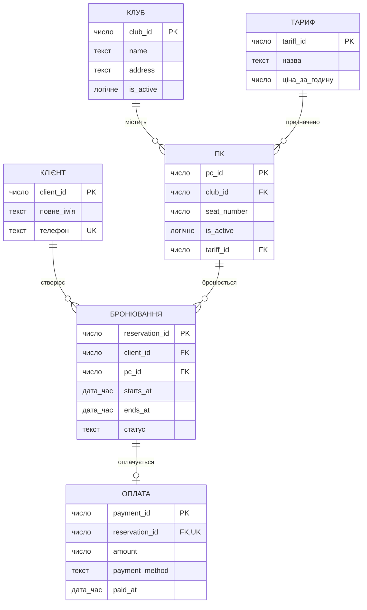
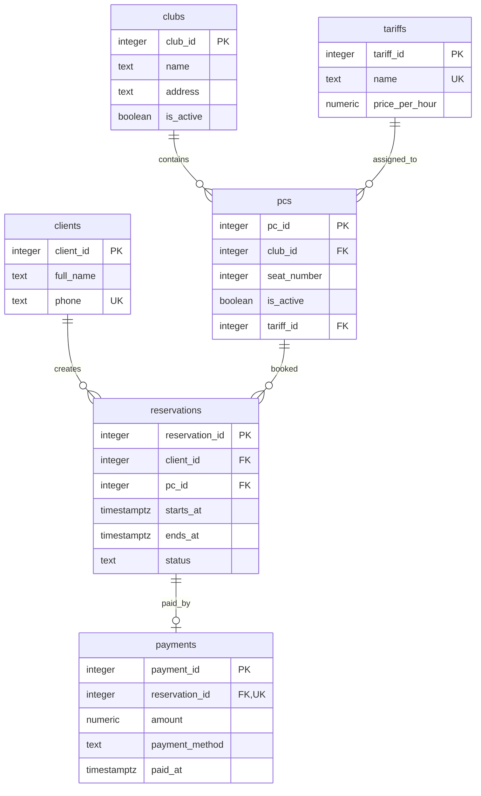

# Лабораторна робота №1. Моделювання предметної області та створення схеми бази даних

Виконавець: **Сургай Володимир**.

Предметна область: **мережа кіберклубів із попереднім бронюванням компʼютерів та оплатою**.

## 1. Предметна область

Мережа кіберклубів надає клієнтам компʼютерні місця для гри за спільними для мережі погодинними тарифами. Кожне місце належить конкретному клубу; його номер унікальний у межах клубу, а внутрішній ідентифікатор ПК унікальний у мережі. Клієнт бронює конкретне місце на визначений проміжок часу; система не дозволяє накладати активні бронювання одного ПК. Бронювання одразу резервує час, а оплату можна зареєструвати пізніше одним платежем. Ціна для бронювання береться з поточного тарифу, призначеного ПК.

## 2. Бізнес-правила

| № | Правило | Де перевіряється | Обмеження або обґрунтування |
|---|---|---|---|
| 1 | Кожен клієнт має окремий ідентифікатор; номер телефону унікальний | схема | `PRIMARY KEY`, `UNIQUE`, `NOT NULL` |
| 2 | `pc_id` є глобальним ID компʼютера, а номер місця додатний і унікальний у межах клубу | схема | `IDENTITY`, `CHECK`, `UNIQUE (club_id, seat_number)` |
| 3 | Кожен ПК має один призначений тариф, який існує | схема | `NOT NULL`, `FOREIGN KEY` |
| 4 | Назва тарифу унікальна і не порожня | схема | `UNIQUE`, `CHECK` |
| 5 | Ціна тарифу не може бути відʼємною; нуль дозволений | схема | `CHECK (price_per_hour >= 0)` |
| 6 | Бронювання належить одному наявному клієнту й одному наявному ПК | схема | `NOT NULL`, `FOREIGN KEY` |
| 7 | Час закінчення бронювання має бути пізніше часу початку | схема | `CHECK (ends_at > starts_at)` |
| 8 | Активні бронювання одного ПК не перетинаються; скасовані не займають час | схема | обмеження `EXCLUDE` для часових інтервалів |
| 9 | Дозволені сусідні бронювання, якщо одне закінчується рівно тоді, коли починається наступне | схема | інтервал напіввідкритий: `[початок, кінець)` |
| 10 | Неактивний ПК не можна забронювати | схема | тригер перевіряє `pcs.is_active` |
| 11 | Ціна для бронювання визначається тарифом, призначеним ПК | через звʼязок таблиць | `reservations.pc_id → pcs.tariff_id → tariffs.price_per_hour` |
| 12 | Статуси бронювання — `active` або `cancelled`; завершення визначається за `ends_at` | схема та запит | `CHECK`; окремий статус «завершена» не зберігається |
| 13 | ПК належить одному клубу; номер місця може повторюватися в різних клубах | схема | `NOT NULL`, `FOREIGN KEY`, `UNIQUE (club_id, seat_number)` |
| 14 | ПК у неактивному клубі не можна забронювати | схема | тригер перевіряє `clubs.is_active` |
| 15 | Бронювання може бути неоплаченим; до нього можна зареєструвати не більше одного платежу | схема | FK `payments.reservation_id` і `UNIQUE` |
| 16 | Платіж має невідʼємну суму й один із підтримуваних способів оплати | схема | `CHECK (amount >= 0)`, `CHECK (payment_method IN (...))` |

## 3. ER-модель



### Сутності

- **Тариф** — назва тарифу та його поточна ціна за годину.
- **Клуб** — філія мережі з назвою, адресою та ознакою активності.
- **ПК** — компʼютерне місце філії; `pc_id` — глобальний ID, а `seat_number` — номер місця в цьому клубі.
- **Клієнт** — людина, яка бронює місце; телефон є унікальним контактним номером.
- **Бронювання** — резервування одного ПК для одного клієнта на часовий інтервал.
- **Оплата** — фактично прийнятий платіж за бронювання, із сумою, способом і часом.

### Звʼязки

- Один тариф може бути призначений нулю або багатьом ПК; кожен ПК має рівно один тариф (1:N).
- Один клуб може містити нуль або багато ПК; кожен ПК належить рівно одному клубу (1:N). Номер місця унікальний тільки в межах свого клубу.
- Один клієнт може створити нуль або багато бронювань; кожне бронювання належить одному клієнту (1:N).
- Один ПК може мати багато бронювань у різний час; кожне бронювання стосується одного ПК (1:N). Часові інтервали активних бронювань не перетинаються.
- Одне бронювання може бути неоплаченим або мати один платіж; кожен платіж належить рівно одному бронюванню (1:0..1).
- Ціна бронювання визначається поточним тарифом ПК через звʼязок таблиць; окрема ціна в `reservations` не зберігається.

### Перевірка за типовими помилками

- [x] Атрибут, який насправді є сутністю: тариф винесено в окрему сутність.
- [x] Звʼязок без кардинальності: усі звʼязки мають кардинальності.
- [x] Одна широка таблиця замість кількох сутностей: клуби, ПК, тарифи, клієнти, бронювання й оплати розділено.
- [x] Телефон або електронна пошта як первинний ключ: клієнт має окремий `client_id`; телефон — унікальний альтернативний ключ.

Результат перевірки: клуб, тариф, клієнт, ПК, бронювання й оплата моделюються окремо; усі звʼязки мають кардинальність; телефон не використовується як первинний ключ.

## 4. Ключі та реакції на видалення

### Первинні ключі

| Сутність | Потенційні ключі | Первинний ключ | Обґрунтування |
|---|---|---|---|
| Клуб | `club_id` | `club_id` | Сурогатний ключ незалежний від перейменування філії чи зміни адреси |
| Клієнт | `client_id`, унікальний `phone` | `client_id` | Сурогатний ключ не залежить від зміни контактного номера |
| ПК | `pc_id`, пара (`club_id`, `seat_number`) | `pc_id` | Глобальний сурогатний ID стабільний, навіть якщо місце перенумерують або перенесуть |
| Тариф | `tariff_id`, унікальна назва | `tariff_id` | Назву тарифу можна перейменувати |
| Бронювання | `reservation_id` | `reservation_id` | Сурогатний ключ стабільно ідентифікує історичний запис |
| Оплата | `payment_id`, унікальний `reservation_id` | `payment_id` | ID платежу не залежить від бронювання; унікальний FK обмежує бронювання одним платежем |

### Реакції на видалення

| Звʼязок | Реакція | Обґрунтування з погляду бізнесу |
|---|---|---|
| Клуб — ПК | `RESTRICT` | Філію з компʼютерами не видаляти; її можна позначити неактивною |
| Клієнт — Бронювання | `RESTRICT` | Не видаляти клієнта, якщо його бронювання потрібні в історії |
| ПК — Бронювання | `RESTRICT` | Не видаляти місце з історією; нові броні можна заборонити через `is_active = false` |
| Тариф — ПК | `RESTRICT` | Не видаляти тариф, призначений компʼютеру |
| Бронювання — Оплата | `RESTRICT` | Не видаляти бронювання, доки зберігається фінансовий запис |

## 5. Нормалізація

Нижче розглядаються тільки шість таблиць цієї схеми: `clubs`, `clients`, `tariffs`, `pcs`, `reservations` і `payments`. Нормалізація описує саме їх, а не іншу предметну область.

### Функціональні залежності в таблицях схеми

Кожна залежність нижче стосується окремої таблиці й випливає з її первинного або альтернативного ключа:

| Таблиця | Ключ | Функціональна залежність |
|---|---|---|
| `clubs` | `club_id` | `club_id → name, address, is_active` |
| `clients` | `client_id` | `client_id → full_name, phone` |
| `clients` | `phone UNIQUE` | `phone → client_id, full_name` |
| `tariffs` | `tariff_id` | `tariff_id → name, price_per_hour` |
| `tariffs` | `name UNIQUE` | `name → tariff_id, price_per_hour` |
| `pcs` | `pc_id` | `pc_id → club_id, seat_number, tariff_id, is_active` |
| `pcs` | `(club_id, seat_number) UNIQUE` | `(club_id, seat_number) → pc_id, tariff_id, is_active` |
| `reservations` | `reservation_id` | `reservation_id → client_id, pc_id, starts_at, ends_at, status` |
| `payments` | `payment_id` | `payment_id → reservation_id, amount, payment_method, paid_at` |
| `payments` | `reservation_id UNIQUE` | `reservation_id → payment_id, amount, payment_method, paid_at` |

У `payments` остання залежність обмежує модель максимум однією оплатою на бронювання. Відсутність рядка в `payments` означає, що бронювання ще не має оплати.

### Як ці таблиці усувають аномалії

Як приклад поганого подання візьмемо одну широку таблицю бронювань, яка повторює поля клубу, клієнта, ПК і тарифу з відповідних таблиць цієї ж схеми:

```text
reservation_id, client_id, full_name, phone,
pc_id, club_id, club_name, address, seat_number,
tariff_id, tariff_name, current_price,
starts_at, ends_at,
payment_id, amount, payment_method, paid_at
```

Для такої таблиці виникають конкретні аномалії:

- **Оновлення:** зміна телефону клієнта або адреси клубу потребує оновити багато рядків бронювань; пропущений рядок створює суперечливі дані.
- **Вставлення:** клієнта, клуб або тариф довелося б додавати разом із фіктивним бронюванням, бо всі дані зберігаються в одному рядку.
- **Видалення:** видалення останнього бронювання клієнта могло б стерти єдині збережені в цій таблиці імʼя й телефон цього клієнта.

У реальній схемі ці атрибути зберігаються у своїх таблицях і повʼязуються зовнішніми ключами. Наприклад, імʼя клієнта зберігається один раз у `clients`, а бронювання містить лише `client_id`.

### Перевірка 1NF, 2NF і 3NF

- **1NF:** у шести таблицях кожен стовпець зберігає одне значення, без списків чи повторюваних груп. Складні множинні дані для цих сутностей не зберігаються в одному полі.
- **2NF:** кожна таблиця має одностовпцевий первинний ключ (`club_id`, `client_id`, `tariff_id`, `pc_id`, `reservation_id` або `payment_id`). Тому немає неключових атрибутів, залежних лише від частини первинного ключа. Унікальний складений ключ ПК `(club_id, seat_number)` також визначає атрибути одного ПК цілком.
- **3NF:** дані клубу, клієнта, тарифу й ПК не зберігаються повторно в `reservations` або `payments`; ці таблиці посилаються на них через FK. Отже, описові атрибути залежать від ключа своєї таблиці, а не від іншого неключового атрибута.

Ціна не дублюється в `reservations`: її можна отримати з `tariffs`, зʼєднавши бронювання з ПК за `pc_id`, а ПК — з тарифом за `tariff_id`. Тому зміна тарифу змінює ціну, яку запит поверне і для старих бронювань.

## 6. Реляційна схема



## 7. Середовище

Операційна система: Windows.

```powershell
docker compose up -d
docker compose ps
```

Фактичний стан PostgreSQL під час перевірки:

```text
NAME              IMAGE           SERVICE    STATUS
dbsa-postgres-1   postgres:18.6   postgres   Up
```

Підключення DBeaver: host `localhost`, port `5432`, database `dbsa`, username `student`, password `student`.

Міграція `001` створює шість таблиць: `clubs`, `clients`, `pcs`, `reservations`, `payments` і `tariffs`. У `reservations` немає окремої ціни: її отримують через тариф, призначений ПК. Наявну базу тут не змінювали; якщо в ній уже є стара версія схеми з `agreed_price_per_hour`, сама зміна SQL-файлу її не оновить. Повторний запуск `down` видалить таблиці й усі їхні дані.

Для демонстраційних даних є окремий [seed-data.sql](seed-data.sql). Він додає один клуб, два місця, тариф, двох клієнтів, бронювання та оплати; файл можна виконати один раз після міграції `001 up`. Наповнення не є обовʼязковою частиною цієї лабораторної.

Дані зберігаються в іменованому томі `pgdata`, підключеному до `/var/lib/postgresql`. `docker compose down` видаляє контейнер, але зберігає том; `docker compose down -v` також видаляє том і дані.

Перевірка збереження: в окремому тимчасовому контейнері створено тестовий рядок, контейнер пересоздано з тим самим томом — рядок залишився. Тимчасовий контейнер і його том після перевірки видалено.

## 8. Створення схеми

- Міграція 001: [migrations/001_create_schema.up.sql](migrations/001_create_schema.up.sql), [migrations/001_create_schema.down.sql](migrations/001_create_schema.down.sql). Вона створює всю погоджену схему мережі кіберклубів із шести сутностей.
- `reservations_no_active_overlap` — обмеження `EXCLUDE` за ПК і часовим інтервалом; скасовані бронювання не враховуються. Воно перевірене тестовим SQL, оскільки наданий скрипт `check-schema.sql` показує обмеження типів `PRIMARY KEY`, `UNIQUE`, `FOREIGN KEY` і `CHECK`.
- Тригер `reservations_check_pc_active` викликає `check_reservation_pc_active()` перед вставленням бронювання або зміною його ПК. Функція лише перевіряє, що ПК і клуб активні; ціни в бронюванні немає.
- Один платіж належить одній броні; `UNIQUE` на `payments.reservation_id` забороняє повторну оплату в цій моделі. `paid_at` за замовчуванням отримує час реєстрації платежу.
- Для індексації виключення використовується розширення PostgreSQL `btree_gist`. Міграція `down` прибирає таблиці й тригерну функцію, але залишає розширення, щоб не видаляти його, якщо воно використовується іншими обʼєктами бази.

## 9. Перевірка обмежень

Файл перевірок: [constraint-checks.sql](constraint-checks.sql). Кожен тестовий `INSERT` виконується окремо: виділи одну команду в DBeaver і запусти її. PostgreSQL відхиляє цю команду; успішно вставлені тестові дані не залишаються.

| Правило | Обмеження | Повідомлення PostgreSQL |
|---|---|---|
| Імʼя клієнта обовʼязкове | `NOT NULL` | `null value in column "full_name" of relation "clients" violates not-null constraint` |
| Телефон унікальний | `UNIQUE` | `duplicate key value violates unique constraint "clients_phone_key"` |
| Ціна не відʼємна | `CHECK` | `new row for relation "tariffs" violates check constraint "tariffs_price_per_hour_check"` |
| ID тарифу — первинний ключ | `PRIMARY KEY` | `duplicate key value violates unique constraint "tariffs_pkey"` |
| Платіж посилається на наявне бронювання | `FOREIGN KEY` | `insert or update on table "payments" violates foreign key constraint "payments_reservation_id_fkey"` |

Додатково перевірено: номер місця унікальний у клубі; некоректний інтервал і бронювання в неактивному клубі або на неактивному ПК відхиляються; сусідні інтервали й бронювання скасованого часу дозволені.

## 10. Цикл up — down — up

Поточний файл `001` у репозиторії створює схему без `agreed_price_per_hour` і з простішою функцією перевірки активності ПК та клубу. Цю редакцію ще не запускали в базі: цикл up — down — up і вивід `check-schema.sql` потрібно оновити після її перевірки. Існуюча база не змінюється автоматично при редагуванні SQL-файлу.
