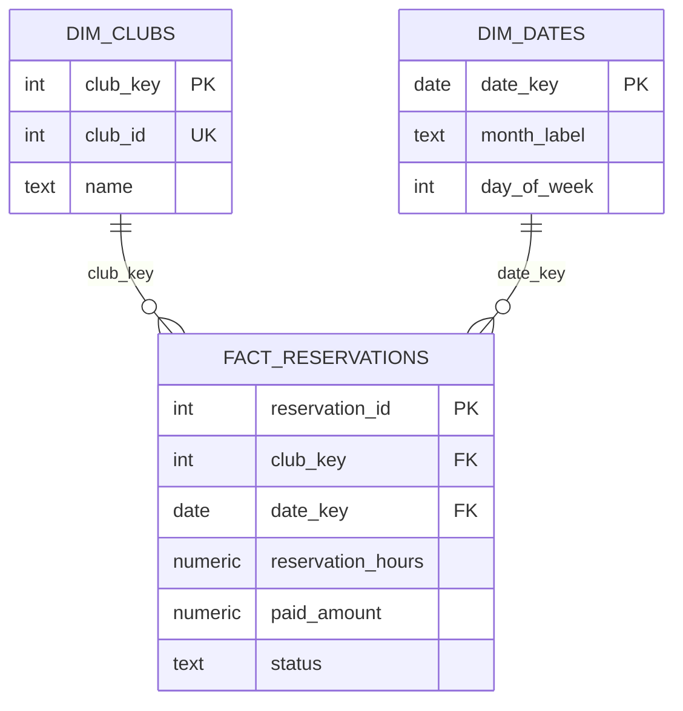

# Лабораторна робота №3. Аналітичні запити та звітність

Виконавець: **Сургай Володимир**.

Предметна область: **мережа кіберклубів із тарифами, компʼютерними місцями, бронюваннями та оплатами**.

У роботі додано шість аналітичних запитів, один спрощений приклад віконної функції, генератор тестового навантаження, індекс, схему «зірка», staging-шар для текстового імпорту й три джерела даних для дашборда. Основні запити виконано на PostgreSQL 18.6.

> **Нумерація міграцій.** У роботі №1 створюється базова схема міграцією `001`. У роботі №2 міграція `002` додає місткість клубів, а `003` — вечірню ціну та промокоди. Міграції роботи №3 мають номери `004`–`006`: індекс, аналітична схема та staging. Для повного запуску з чистої БД спочатку застосуйте `001`, завантажте `lab-02/seed-data.sql`, потім застосуйте `002` і `003`; після цього виконуйте міграції та завантажувачі Lab 3. Seed має бути до 003, бо його `INSERT` тарифів не задає нове обовʼязкове поле `evening_price`.

## 1. Запити на показники

Файл: [analytic-queries.sql](analytic-queries.sql).

| № | Питання | Конструкції | Результат на seed-даних |
|---|---|---|---|
| 1 | Скільки бронювань кожного статусу? | `GROUP BY` | `active` — 11, `cancelled` — 1 |
| 2 | Які клуби заробили понад 250 у березні? | `JOIN`, `WHERE`, `GROUP BY`, `HAVING` | Center — 5 оплат на 1040; Campus — 1 на 300 |
| 3 | Активні бронювання та оплати для кожного ПК? | `LEFT JOIN`, `CASE` в агрегаті | PC1 — 3/1; PC2 — 1/1; PC3 — 1/1; PC4 — 2/2; PC5 — 2/0; PC6 — 2/2 |
| 4 | Скільки оплат більші за середню? | Підзапит у `WHERE` | 4; середня оплата — 277.14 |
| 5 | Середня кількість бронювань на день із бронюваннями? | Підзапит у `FROM`, `GROUP BY` | 1.20 бронювання на день |
| 6 | Скільки бронювань у кожному клубі, включно з порожнім? | Два `LEFT JOIN`, `count(стовпець)` | Center — 6; Riverside — 4; Campus — 2; Empty — 0 |

Умова після агрегування належить до `HAVING`: перенесення її до `WHERE` некоректне, бо `WHERE` відбирає рядки до `GROUP BY`, а агрегатів ще немає. Для порожнього клубу `LEFT JOIN` створює рядок із `NULL` у стовпцях бронювання: `count(*)` порахував би цей рядок як 1, а `count(reservation_id)` — як 0.

## 2. Один приклад віконної функції

Файл: [window-queries.sql](window-queries.sql).

У [window-queries.sql](window-queries.sql) показано суму оплат за ПК поруч із кожною оплатою. `PARTITION BY pc_id` рахує підсумок окремо для кожного ПК. Для PC6 дві оплати по 300 лишаються двома рядками, і в обох `pc_paid_total` дорівнює 600. На відміну від `GROUP BY`, віконна функція зберігає окремі рядки.

## 3. Дослід з індексом

Файл генерації: [generate-data.sql](generate-data.sql). Його потрібно запускати в тій самій базі Lab 3 — один раз і вже після експорту CSV на seed-даних. Після генерації в таблиці було 100 012 бронювань. Запит: `SELECT * FROM reservations WHERE client_id = 42`.

| Показник | До індексу | Після індексу |
|---|---|---|
| План | `Seq Scan` | `Bitmap Index Scan` + `Bitmap Heap Scan` |
| Рядки, відкинуті фільтром | 100 002 | індекс знайшов 10 рядків |
| Типовий час із серії замірів | приблизно 3.5 мс | приблизно 0.1 мс |

Міграція: [004 up](migrations/004_add_reservations_client_id_index.up.sql), [004 down](migrations/004_add_reservations_client_id_index.down.sql). Цикл `up → down → up` перевірено. У виміряному екземплярі таблиця займала 6 672 KiB, індекс — 936 KiB. Індекс прискорює пошук, але потребує місця та додаткової роботи під час вставлення/оновлення.

Індекс не допоміг пошуку `phone LIKE '%000001'`: план — `Seq Scan` (1.059 мс), оскільки індекс створено на `reservations.client_id`, а умова стосується іншого стовпця та має шаблон із початковим `%`. Для `client_id <> 42` план також `Seq Scan` (9.149 мс): умова повертає майже всю таблицю, тому вибірковий індекс не вигідний.

## 4. Два навантаження

На тому самому наборі з 100 012 рядків пошук за `client_id = 42` використав bitmap-індекс і виконався за 0.216 мс у контрольному замірі. Аналітика `GROUP BY starts_at::date` прочитала всю таблицю через `Seq Scan`, згрупувала 358 дат і виконалася за 22.390 мс. Індекс корисний для вибіркового пошуку, але не усуває повне читання для звіту за всіма датами.

| Питання | Тип | Частота | Якщо дані сховища відстають на годину |
|---|---|---|---|
| Чи вільне конкретне місце зараз? | оперативне | часто | неприйнятно — читати робочу БД |
| Скільки активних бронювань у клієнта зараз? | оперативне | під час оформлення | неприйнятно — читати робочу БД |
| Яка виручка за день/місяць? | аналітичне | періодично | зазвичай прийнятно |
| Який клуб/тариф популярніший за період? | аналітичне | щодня/щотижня | прийнятно для звіту |

Для цієї навчальної системи достатньо нічного завантаження сховища: оперативні рішення лишаються в OLTP, а звіти читають окрему аналітичну модель. Якщо користувачеві потрібні цифри за поточну годину, частоту треба підвищити.

## 5. Схема «зірка»

Зерно факту: один рядок відповідає одному бронюванню. `reservation_hours` можна підсумовувати, а `paid_amount` — підсумовувати як сплачену виручку; статус є контекстом, а не числовою мірою.

| Вимір | Ключ | Описові стовпці |
|---|---|---|
| `dim_clubs` | сурогатний `club_key`; природний `club_id` унікальний | назва, адреса, активність |
| `dim_dates` | природний ключ — дата | рік, місяць, день тижня, вихідний |

`fact_reservations` зберігає ідентифікатор бронювання, ключі клубу/дати, години, суму оплати та статус. Імена клієнтів, номери ПК та інші операційні деталі не потрібні для вибраних показників.

Назва клубу повторюється в `dim_clubs` для зручного групування. Це не створює аномалій у фактах: атрибут має одне місце редагування у вимірі. `dim_dates` також денормалізує календарні атрибути, щоб не обчислювати їх у кожному звіті.

## 6. Міграція зірки

Схему створює [міграція 005 up](migrations/005_create_star_schema.up.sql), відкатує [005 down](migrations/005_create_star_schema.down.sql). Таблиці створюються як `dim_clubs`, `dim_dates`, `fact_reservations`; цикл `up → down → up` пройшов у тестовій БД. Після `up` наявні всі три таблиці, після `down` їх немає, повторний `up` відновлює ту саму схему.

## 7. Завантаження

Завантажувач: [load-star.sql](load-star.sql). Три команди `INSERT ... SELECT` виконуються в порядку клуби → календар дат → факти, бо факти мають зовнішні ключі на виміри. У кожній команді є `ON CONFLICT`.

| Таблиця / показник | До завантаження | Після першого | Після другого |
|---|---:|---:|---:|
| `dim_clubs`, рядків | 0 | 4 | 4 |
| `dim_dates`, рядків | 0 | 51 | 51 |
| `fact_reservations`, рядків | 0 | 12 | 12 |
| сума оплат фактів | 0 | 1940.00 | 1940.00 |

Повторне завантаження не додало рядків: порівнювали `count(*)` і суму, а не повідомлення `INSERT`. Перевірено зміну оплати бронювання №1 з 200 на 250: повторний `load-star.sql` оновив факт до 250; після повернення джерела на 200 повторний запуск повернув факт до 200. Після staging у факті є 13 рядків.

## 8. Брудні дані

Staging створюють [міграції 006 up](migrations/006_create_staging.up.sql) і [006 down](migrations/006_create_staging.down.sql); дані — [stage-source.sql](stage-source.sql), завантаження — [stage-load.sql](stage-load.sql). Усі вхідні поля спершу є текстом; `pg_input_is_valid` відсіює помилки до перетворення типів, а суперечності перевіряються після нього.

| Рядок | Проблема | Етап | Обмеження цільової схеми |
|---|---|---|---|
| 1 | порожній необов'язковий `paid_amount_raw` означає, що оплати ще немає | залишено; `NULL` перетворено на 0 | відсутня оплата — не помилка бронювання |
| 2 | некоректна дата `not-a-date` | відхилено до перетворення | тип `timestamptz` |
| 3 | повтор рядка 1; порожня сума також допустима | `DISTINCT` після перетворення | PK `reservation_id` |
| 4 | відсутній обов'язковий `client_id` | відхилено до перетворення | `NOT NULL` у робочій схемі |
| 5 | час завершення раніше за початок | відхилено після перетворення | `CHECK (ends_at > starts_at)` у робочій моделі |
| 6 | статус `pending` не дозволений | відхилено після перетворення | `CHECK`/домен статусу |

У staging-файлі 6 рядків: 4 відхилено з причиною, один дублікат прибрано, один факт №90001 завантажено. Порожній необов'язковий платіж означає 0, а не помилку; порожній `client_id` не проходить, бо це обов'язкове посилання. Значення `club_id = 1` зіставляється з уже наявним клубом у вимірі. Повторний запуск staging залишив кількість фактів незмінною (13).

## 9. Показники та дашборд

SQL: [dashboard-queries.sql](dashboard-queries.sql). CSV-експорти: [виручка](dashboard-revenue.csv), [бронювання за клубами](dashboard-clubs.csv), [денна виручка](dashboard-daily.csv). Результати отримані після завантаження staging. Є [скриншот реального звіту Looker Studio](dashboard-looker-studio.png) та [локальне прев'ю](dashboard-preview.png).

| Елемент | Показник | Результат |
|---|---|---|
| картка | оплачена виручка березня 2026 | 1540.00 |
| стовпчикова діаграма | бронювання за клубами | Center 7; Riverside 4; Campus 2; Empty 0 |
| часовий ряд | денна оплачена виручка | 200, 300, 540, 200, 300 на дні з оплатами |

У Looker Studio фактично побудовано картку `revenue` зі значенням 1540, стовпчикову діаграму `club` / `reservation_count` і часовий ряд `day` / `revenue` за березень; пропущені дні мають нульову виручку.

Клуб у другому запиті береться з виміру `dim_clubs`, отже `LEFT JOIN` додає й клуб без фактів. У запиті 6 розділу 1 перелік усіх клубів діставався з робочої таблиці `clubs` через `LEFT JOIN`, бо самі бронювання не містять рядка для порожнього клубу.

### Обґрунтування способу передавання даних

Дані для візуалізації передаються до Looker Studio через CSV-експорт запитів-вітрин, а не прямим мережевим підключенням до PostgreSQL. База працює в Docker на локальній робочій станції; Looker Studio є зовнішнім сервісом і не може звернутися до локального `localhost` без окремого тунелю або публікації сервера. Для навчальної роботи CSV дає змогу передати результат без відкриття локальної бази назовні.

Кожен CSV має стабільний набір полів і гранулярність, потрібні відповідній візуалізації: один рядок із виручкою за період, рядок на клуб і рядок на календарний день. Це схема результатів запитів-вітрин, а не копія всіх рядків таблиць фактів і вимірів. У робочому середовищі ті самі вітрини можна буде отримувати через драйвер/конектор до централізованого сховища. Якщо колонки й типи результатів збережуться, достатньо переналаштувати джерело даних у Looker Studio — самі графіки перебудовувати не потрібно.

| CSV-джерело | Поля й типи | Гранулярність | Візуалізація |
|---|---|---|---|
| `dashboard-revenue.csv` | `period` — текст `YYYY-MM`; `revenue` — число | один рядок на місяць | картка: `SUM(revenue)` |
| `dashboard-clubs.csv` | `club` — текст; `reservation_count` — ціле число | один рядок на клуб | стовпчикова діаграма: клуб / `SUM(reservation_count)` |
| `dashboard-daily.csv` | `day` — дата у форматі `YYYYMMDD`; `revenue` — число | один рядок на календарний день березня, включно з нульовою виручкою | часовий ряд: `day` як Date / `SUM(revenue)` |

У `dashboard-daily.csv` дата записана як `YYYYMMDD` (наприклад, `20260305`), щоб імпорт із різними локалями не переставляв день і місяць. У джерелі Looker Studio для поля `day` треба вказати тип **Date** і формат `YYYYMMDD`; у часовому ряді використати денну гранулярність.

## 10. Повний прогін і відтворюваність

Для повного нового прогону використовуй **одну базу `dbsa_check`**: `001` → seed → `002` → `003` → `analytic-queries.sql` → `window-queries.sql` → `005 up` → `load-star.sql` → `006 up` → `stage-source.sql` → `stage-load.sql` → `dashboard-queries.sql` та експорт CSV. Лише після експорту запусти `generate-data.sql`, зніми план і розміри до індексу, застосуй `004 up` і повтори заміри. Міграція 004 навмисно виконується після 005/006, щоб отримати порівняння без індексу; ці міграції не залежать одна від одної.

Генератор додає навантажувальні рядки в ту саму робочу таблицю `reservations`; запускай його лише один раз. CSV і виміри зірки формуються до генератора на невеликому наборі даних. Після генерації не запускай `load-star.sql` повторно, якщо хочеш зберегти контрольні значення звіту. Для підрахунку рядків додано [lab-02/count-rows.sql](../lab-02/count-rows.sql). Міграції 002 і 003 доступні в `lab-02/migrations`; у чистій базі їх застосовують після seed.

Для вимірювання згенеровано 100 000 бронювань плюс 12 seed-рядків. Середній розмір рядка з вимірювання — близько 68.31 байта. При навчальному припущенні 45 ПК × 6 бронювань на день × 365 днів це 98 550 бронювань, приблизно 6.42 MiB табличних даних за рік (без індексів). Це оцінка, а не прогноз реального навантаження.
