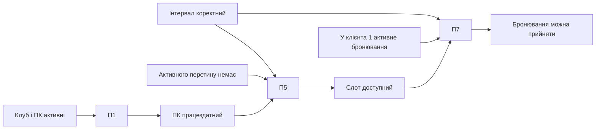
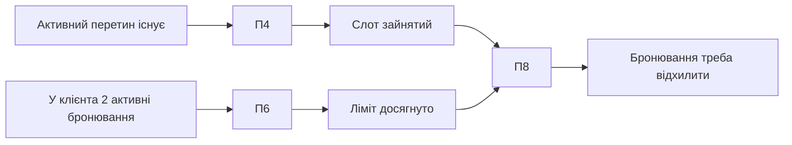
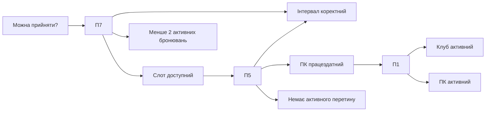
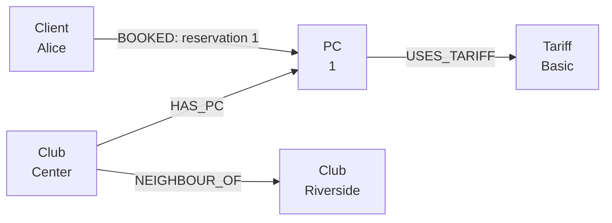

# Лабораторна робота №5. Організація знань предметної області

Виконавець: **Сургай Володимир**.

Предметна область: **мережа кіберклубів, бронювання та оплати**.

## 1–2. База правил і джерела умов

Файл: [rules.md](rules.md). Правила описують рішення для одного запиту бронювання.

| № | ЯКЩО | ТО |
|---|---|---|
| П1 | клуб активний і вибраний ПК активний | ПК працездатний |
| П2 | вибраний ПК неактивний | ПК недоступний |
| П3 | вибраний клуб неактивний | клуб недоступний |
| П4 | є активне бронювання цього ПК, що перетинається із запитом | слот зайнятий |
| П5 | ПК працездатний, інтервал коректний, активного перетину немає | слот доступний |
| П6 | у клієнта щонайменше два активні бронювання | клієнт досяг ліміту |
| П7 | слот доступний, інтервал коректний, у клієнта менше двох активних бронювань | бронювання можна прийняти |
| П8 | ПК/клуб недоступний, слот зайнятий або клієнт досяг ліміту | бронювання треба відхилити |

| Умова | Джерело |
|---|---|
| активність клубу/ПК | `clubs.is_active`, `pcs.is_active` |
| активність та час наявних бронювань | `reservations.status`, `starts_at`, `ends_at`, `pc_id` |
| активні бронювання клієнта | підрахунок `reservations` за `client_id` і `status` |
| інтервал нового запиту | введення клієнта, перевіряє застосунок (`ends_at > starts_at`) |
| «ПК працездатний», «слот доступний», «досяг ліміту» | висновки П1, П5 і П6 |

П1, П2, П3, П4 і П6 спираються на початкові факти; П5, П7 і П8 — на висновки. Умова про запит, який ще не збережений, відсутня в схемі роботи №1: потрібні дані вводить клієнт, а коректність інтервалу перевіряє застосунок. Перевірка перетину має враховувати конкурентні запити; у PostgreSQL остаточним захистом лишається обмеження робочої схеми.

П7 та П8 ведуть до протилежних висновків. Їхні умови розділені вимогами П7: слот вільний і активних бронювань клієнта менше двох; для відмови достатньо хоча б однієї причини з П8.

## 3. Два прогони прямого виведення

Порядок застосування правил — за номером. Повторний цикл починається після додавання нових фактів; процес зупиняється на нерухомій точці.

### Прогін 1: вільне місце можна забронювати

Початкові факти: клуб активний; ПК активний; інтервал коректний; активного перетину немає; у клієнта одне активне бронювання; клієнт підтвердив запит.

Початковий конфліктний набір: П1.

| Цикл | Правило | Новий факт |
|---:|---|---|
| 1 | П1 | ПК працездатний |
| 2 | П5 | слот доступний |
| 3 | П7 | бронювання можна прийняти |
| 4 | — | нових фактів немає |

Було 6 фактів, стало 9. П2, П3, П4, П6 і П8 не спрацювали — їхні умови відсутні, це не помилка бази правил.

### Прогін 2: конфліктне бронювання треба відхилити

Початкові факти: клуб і ПК активні; інтервал коректний; існує активний перетин на тому самому ПК; у клієнта вже два активні бронювання; клієнт підтвердив запит.

Початковий конфліктний набір: П1, П4, П6.

| Цикл | Правило | Новий факт |
|---:|---|---|
| 1 | П1 | ПК працездатний |
| 1 | П4 | слот зайнятий |
| 1 | П6 | клієнт досяг ліміту |
| 2 | П8 | бронювання треба відхилити |
| 3 | — | нових фактів немає |

Було 6 фактів, стало 10. П2, П3, П5 і П7 не спрацювали. Правила не змінювалися — змінилися вхідні факти.

## 4. Ланцюжки виведення

### Прогін 1

Висновок: бронювання можна прийняти.



Факт підтвердження запиту був у робочій пам'яті, але не впливав на жодне з восьми правил. Для замовника: «Місце вільне, комп'ютер працює, клієнт не досяг ліміту — бронювання можна оформити».

### Прогін 2

Висновок: бронювання треба відхилити.



П1 також спрацювало, але не входить до ланцюжка відмови. Для замовника: «Цей час уже зайнятий, а клієнт має максимальну кількість активних бронювань — запит відхилено».

## 5. Зворотне виведення

### Гіпотеза підтверджується

Гіпотеза: «бронювання можна прийняти» (П7). Для її доведення потрібні доступний слот, коректний інтервал і менше двох активних бронювань. Доступність слота доводиться П5, а працездатність ПК — П1.



Не потрібні П2, П3, П4, П6 і П8. Прямий прогін перевіряє правила, що мають нові факти; зворотний починає з потрібного висновку та розкриває лише залежні підцілі.

### Гіпотеза не підтверджується

Для першого прогону гіпотеза «бронювання треба відхилити» не підтверджується: немає факту «слот зайнятий», «ресурс недоступний» або «ліміт досягнуто». Якщо застосовано припущення замкненого світу, відсутність факту трактують як «ні»; це не доказ того, що фактичні дані точно перевірені. У реальній системі пропуск даних може спричинити неправильне прийняття рішення.

Робочі SQL-запити робіт №2–3 повертають фактичні рядки з БД, а не пояснюють ланцюг виведення; для тієї самої бізнес-умови знадобилися б перевірки статусу, перетину інтервалу й кількості бронювань.

## 6–7. Граф знань і його створення

Файли: [graph.cypher](graph.cypher), [queries.cypher](queries.cypher). Граф містить підграф для бронювань №1, №2 і №8.

| Мітка | Сутність | Ідентифікатор | Інші властивості |
|---|---|---|---|
| `Club` | клуб | `club_id` | назва, адреса, активність |
| `PC` | комп'ютерне місце | `pc_id` | номер місця, активність |
| `Tariff` | тариф | `tariff_id` | назва, ціна |
| `Client` | клієнт | `client_id` | ім'я, телефон |
| `BOOKED` | бронювання між клієнтом і ПК | `reservation_id` | час, статус, оплата |

| Зв'язок | Від → до | Значення |
|---|---|---|
| `HAS_PC` | `Club` → `PC` | місце належить клубу |
| `USES_TARIFF` | `PC` → `Tariff` | тариф місця |
| `BOOKED` | `Client` → `PC` | бронювання з атрибутами на зв'язку |
| `NEIGHBOUR_OF` | `Club` → `Club` | додаткове знання про сусідство |

Реляційній схемі відповідають мітки вузлів і `HAS_PC`/`USES_TARIFF`; `BOOKED` переносить атрибути рядка бронювання на ребро. `NEIGHBOUR_OF` — нове знання, якого не було в роботі №1; у PostgreSQL для нього потрібна окрема таблиця зв'язків клубів.



Скрипт використовує `MERGE` для вузлів та зв'язків. Вузли спочатку знаходяться через `MATCH`, після чого `MERGE` створює тільки потрібне ребро. Повторний запуск залишив 12 вузлів і 12 зв'язків — дублікатів і порожніх вузлів не з'явилося. Ідея схожа на ідемпотентний `INSERT ... ON CONFLICT` у роботі №2: повторна команда не додає копію.

## 8. Три запити Cypher

1. **Активні бронювання без оплати.** Зразок під запит повернув Andrew Baker, бронювання №2, PC1.

   ```cypher
   MATCH (client:Client)-[booking:BOOKED]->(pc:PC)
   WHERE booking.status = 'active'
     AND booking.payment_amount IS NULL
   RETURN client.full_name, booking.reservation_id, pc.pc_id
   ORDER BY booking.reservation_id;
   ```

2. **Клуби за одним або двома зв'язками сусідства.** Результат: Riverside — 1 крок, Campus — 2 кроки. SQL потребував би окремої кількості self-join для кожної максимальної глибини; `*1..2` задає діапазон довжини шляху в графі.

   ```cypher
   MATCH path = (start:Club {club_id: 1})-[:NEIGHBOUR_OF*1..2]-(other:Club)
   RETURN other.name, length(path)
   ORDER BY length(path), other.name;
   ```

3. **Перевірка П6:** клієнти з щонайменше двома активними бронюваннями. Результат: Alice Anderson — 2.

   ```cypher
   MATCH (client:Client)-[booking:BOOKED]->(:PC)
   WHERE booking.status = 'active'
   WITH client, count(booking) AS active_reservations
   WHERE active_reservations >= 2
   RETURN client.full_name, active_reservations;
   ```

Третій запит перевіряє одну умову правила, але не є механізмом виведення: він не застосовує весь ланцюг П1–П8 і не формує пояснення рішення.

## 9. Знання проти даних

Роботи №1–4 зберігають факти предметної області та виконані операції. Робота №5 окремо описує правила, походження умов і пояснення висновку. Для рішення треба записувати факти на момент запиту, версію `rules.md`/Git commit, ланцюг застосованих правил і підтвердження відповідальної людини. Без версії правил неможливо відтворити, чому однакові дані в різний час дали різні рішення.

Предметний експерт — адміністратор бронювань клубу: він визначає правила прийняття запиту та підтверджує рішення з операційними наслідками. Як і в попередніх роботах, важливі джерело кожного факту та цілісність посилань.

Задача із зірочкою — програмний механізм прямого виведення — не реалізовувалась; ручні прогони та три Cypher-запити наведено вище.

## 10. Протокол запуску середовища

```powershell
docker compose -f lab-05\compose-neo4j.yaml up -d
docker compose -f lab-05\compose-neo4j.yaml ps
```

Під час перевірки контейнер Neo4j 5.26.30 працював; `RETURN 1 AS ok` повернув `1`. Скрипт `graph.cypher` формує 12 вузлів і 12 зв'язків; `down -v` не запускати, якщо потрібно зберегти дані у volume.
