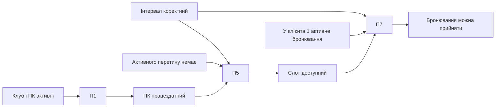
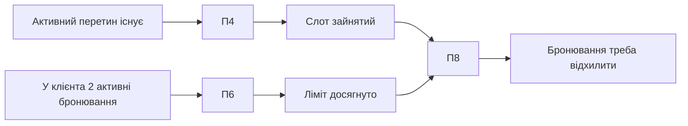
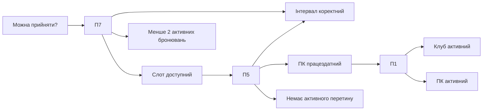
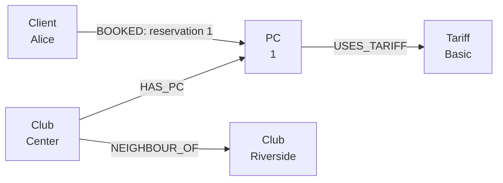

# Лабораторна робота №5. Організація знань предметної області

Виконавець: **Сургай Володимир**.

Предметна область: **мережа кіберклубів, бронювання та оплати**.

## 1. База правил

Файл: [rules.md](rules.md). Правила описують рішення для одного запиту бронювання.

| № | ЯКЩО | ТО |
|---|---|---|
| П1 | клуб активний і вибраний ПК активний | ПК працездатний |
| П2 | вибраний ПК неактивний | ПК недоступний |
| П3 | вибраний клуб неактивний | клуб недоступний |
| П4 | є активне бронювання цього ПК, що перетинається із запитом | слот зайнятий |
| П5 | ПК працездатний, інтервал коректний, активного перетину немає | слот доступний |
| П6 | у клієнта щонайменше два активні бронювання | клієнт досяг ліміту |
| П7 | слот доступний, інтервал коректний, у клієнта менше двох активних бронювань | бронювання можна прийняти |
| П8 | ПК/клуб недоступний, слот зайнятий або клієнт досяг ліміту | бронювання треба відхилити |
| П9 | вибране активне бронювання не має пов'язаного платежу | оплату за бронювання не зафіксовано |

## 2. Джерело кожної умови

| Правило | Умова | Джерело |
|---|---|---|
| П1 | клуб активний; ПК активний | `clubs.is_active`; `pcs.is_active` |
| П2 | ПК неактивний | `pcs.is_active` |
| П3 | клуб неактивний | `clubs.is_active` |
| П4 | активне бронювання цього ПК перетинає запит | `reservations.status`, `pc_id`, `starts_at`, `ends_at` |
| П5 | ПК працездатний; інтервал коректний; активного перетину немає | висновок П1; час запиту; пошук у `reservations` |
| П6 | щонайменше два активні бронювання клієнта | підрахунок `reservations` за `client_id` і `status` |
| П7 | слот вільний; інтервал коректний; у клієнта менше двох активних | висновок П5; час запиту; підрахунок `reservations` |
| П8 | ресурс недоступний, слот зайнятий або ліміт досягнуто | висновки П2, П3, П4 або П6 |
| П9 | активне бронювання без пов'язаного платежу | `reservations.status`; відсутність рядка `payments` з цим `reservation_id` |

П1, П2, П3, П4, П6 і П9 спираються на початкові факти; П5, П7 і П8 — на висновки. П9 перевіряє оплату вже створеного бронювання, лише фіксує її відсутність і не відхиляє бронювання. Умова про запит, який ще не збережений, відсутня в схемі роботи №1: потрібні дані вводить клієнт, а коректність інтервалу перевіряє застосунок. Перевірка перетину має враховувати конкурентні запити; у PostgreSQL остаточним захистом лишається обмеження робочої схеми.

П7 та П8 ведуть до протилежних висновків. Їхні умови розділені вимогами П7: слот вільний і активних бронювань клієнта менше двох; для відмови достатньо хоча б однієї причини з П8.

## 3. Два прогони прямого виведення

Порядок застосування правил — за номером. Повторний цикл починається після додавання нових фактів; процес зупиняється на нерухомій точці.

### Прогін 1: вільне місце можна забронювати

Початкові факти: клуб активний; ПК активний; інтервал коректний; активного перетину немає; у клієнта одне активне бронювання; клієнт підтвердив запит.

Початковий конфліктний набір: П1.

| Цикл | Правило | Новий факт |
|---:|---|---|
| 1 | П1 | ПК працездатний |
| 2 | П5 | слот доступний |
| 3 | П7 | бронювання можна прийняти |
| 4 | — | нових фактів немає |

Було 6 фактів, стало 9. П2, П3, П4, П6 і П8 не спрацювали — їхні умови відсутні, це не помилка бази правил. П9 не застосовується до ще не збереженого запиту.

### Прогін 2: конфліктне бронювання треба відхилити

Початкові факти: клуб і ПК активні; інтервал коректний; існує активний перетин на тому самому ПК; у клієнта вже два активні бронювання; клієнт підтвердив запит.

Початковий конфліктний набір: П1, П4, П6.

| Цикл | Правило | Новий факт |
|---:|---|---|
| 1 | П1 | ПК працездатний |
| 1 | П4 | слот зайнятий |
| 1 | П6 | клієнт досяг ліміту |
| 2 | П8 | бронювання треба відхилити |
| 3 | — | нових фактів немає |

Було 6 фактів, стало 10. П2, П3, П5 і П7 не спрацювали. П9 не застосовується до нового запиту, бо його ще не збережено як бронювання. Правила не змінювалися — змінилися вхідні факти.

### Окрема перевірка П9: бронювання без оплати

Бронювання №2 має статус `active`, але пов'язаного платежу немає. П9 дає висновок «оплату не зафіксовано». Це не автоматична відмова: чинна база правил дозволяє активне бронювання без запису про оплату.

## 4. Ланцюжки виведення

### Прогін 1

Висновок: бронювання можна прийняти.



Факт підтвердження запиту був у робочій пам'яті, але не впливав на жодне з дев'яти правил. Для замовника: «Місце вільне, комп'ютер працює, клієнт не досяг ліміту — бронювання можна оформити».

### Прогін 2

Висновок: бронювання треба відхилити.



П1 також спрацювало, але не входить до ланцюжка відмови. Для замовника: «Цей час уже зайнятий, а клієнт має максимальну кількість активних бронювань — запит відхилено».

## 5. Зворотне виведення

### Гіпотеза підтверджується

Гіпотеза: «бронювання можна прийняти» (П7). Для її доведення потрібні доступний слот, коректний інтервал і менше двох активних бронювань. Доступність слота доводиться П5, а працездатність ПК — П1.



Не потрібні П2, П3, П4, П6, П8 і П9. За підрахунком повних проходів прямий прогін перевіряє 9 правил у кожному з 4 циклів першого набору (до порожнього циклу включно, максимум 36 перевірок); доказ прийняття у зворотному напрямку використовує лише П7, П5 і П1 (3 правила).

### Гіпотеза не підтверджується

Для першого прогону гіпотеза «слот зайнятий» не підтверджується: П4 не знаходить активного перетину, а в початкових фактах явно сказано, що перетину немає.


Тут відомо, що умова хибна, бо є явний факт «перетину немає». Якщо вхідні факти взагалі не містять відповіді про перетин, це означає «нічого не відомо», а не «перетину точно немає»; за припущенням замкненого світу система все одно трактувала б відсутність факту як «ні». Для бронювання це небезпечно: неповні дані можуть помилково дозволити конфліктний слот.

Робочі SQL-запити робіт №2–3 повертають фактичні рядки з БД, а не пояснюють ланцюг виведення; для тієї самої бізнес-умови знадобилися б перевірки статусу, перетину інтервалу й кількості бронювань.

## 6. Граф знань

Файли: [graph.cypher](graph.cypher), [queries.cypher](queries.cypher). Граф містить підграф для бронювань №1, №2 і №8.

| Мітка | Сутність | Ідентифікатор | Інші властивості |
|---|---|---|---|
| `Club` | клуб | `club_id` | назва, адреса, активність |
| `PC` | комп'ютерне місце | `pc_id` | номер місця, активність |
| `Tariff` | тариф | `tariff_id` | назва, ціна |
| `Client` | клієнт | `client_id` | ім'я, телефон |
| `BOOKED` | бронювання між клієнтом і ПК | `reservation_id` | час, статус, оплата |

| Тип зв'язку | Від мітки | До мітки | Властивості зв'язку |
|---|---|---|---|
| `HAS_PC` | `Club` | `PC` | — |
| `USES_TARIFF` | `PC` | `Tariff` | — |
| `BOOKED` | `Client` | `PC` | reservation ID, time, status, payment |
| `NEIGHBOUR_OF` | `Club` | `Club` | — |

| Таблиця Lab 1 | Граф знань |
|---|---|
| `clubs` | вузол `Club` |
| `pcs` | вузол `PC` |
| `tariffs` | вузол `Tariff` |
| `clients` | вузол `Client` |
| `pcs.club_id` | `HAS_PC` від `Club` до `PC` |
| `pcs.tariff_id` | `USES_TARIFF` від `PC` до `Tariff` |
| `reservations` | зв'язок `BOOKED` з ID, часом і статусом бронювання |
| `payments` | властивості суми й способу оплати зв'язку `BOOKED` |
| немає в схемі Lab 1 | `NEIGHBOUR_OF`, додане знання про сусідство клубів |

`NEIGHBOUR_OF` — нове знання, якого не було в роботі №1: таблиця `clubs` не зберігає сусідство. У PostgreSQL для нього потрібна окрема таблиця зв'язків клубів.



## 7. Скрипт створення графа

Файл: [graph.cypher](graph.cypher).

| Запуск | Вершин | Зв'язків |
|---|---:|---:|
| після першого | 12 | 12 |
| після другого | 12 | 12 |

У скрипті вузли знаходяться через `MATCH`, а `MERGE` створює зв'язки ідентифіковано. Повторний запуск не створив копій; це повторює ідемпотентний `INSERT ... ON CONFLICT DO NOTHING` роботи №2.

## 8. Три запити Cypher

1. **Активні бронювання без оплати.** Зразок під запит повернув Andrew Baker, бронювання №2, PC1.

   ```cypher
   MATCH (client:Client)-[booking:BOOKED]->(pc:PC)
   WHERE booking.status = 'active'
     AND booking.payment_amount IS NULL
   RETURN client.full_name, booking.reservation_id, pc.pc_id
   ORDER BY booking.reservation_id;
   ```

2. **Клуби за одним або двома зв'язками сусідства.** Результат: Riverside — 1 крок, Campus — 2 кроки. SQL потребував би окремої кількості self-join для кожної максимальної глибини; `*1..2` задає діапазон довжини шляху в графі.

   ```cypher
   MATCH path = (start:Club {club_id: 1})-[:NEIGHBOUR_OF*1..2]-(other:Club)
   RETURN other.name, length(path)
   ORDER BY length(path), other.name;
   ```

3. **Перевірка П6:** клієнти з щонайменше двома активними бронюваннями. Результат: Alice Anderson — 2.

   ```cypher
   MATCH (client:Client)-[booking:BOOKED]->(:PC)
   WHERE booking.status = 'active'
   WITH client, count(booking) AS active_reservations
   WHERE active_reservations >= 2
   RETURN client.full_name, active_reservations;
   ```

Третій запит перевіряє одну умову правила, але не є механізмом виведення: він не застосовує весь ланцюг П1–П9 і не формує пояснення рішення.

## 9. Знання проти даних

Роботи №1–4 зберігають факти та виконані операції; правила роботи №5 походять від предметного експерта. Їхні межі — один запит бронювання та факти, доступні на момент перевірки; відсутність факту обробляється за припущенням замкненого світу. За рішення відповідають адміністратор клубу та конкретна версія правил, а не сама база даних.

Предметний експерт — адміністратор бронювань клубу: він визначає правила прийняття запиту та підтверджує рішення з операційними наслідками. Як і в попередніх роботах, важливі джерело кожного факту та цілісність посилань.

### Запис журналу рішень

Висновок: прийняти тестове бронювання за обставин прогону 1.

| Пункт | Запис |
|---|---|
| Факти на момент рішення | клуб і ПК активні; інтервал коректний; перетину немає; у клієнта одне активне бронювання |
| Версія бази правил | `rules.md` v2; Git-коміт записати після фіксації змін |
| Ланцюжок виведення | П1 → П5 → П7 |
| Хто підтверджує | адміністратор бронювань клубу |

Без версії правил неможливо відтворити, чому ті самі вхідні факти дали конкретний висновок. Вимога до джерела даних повторює роботи №1–4: для кожної умови є таблиця/стовпець або вказано, що її задає людина.

## 10. Задача із зірочкою: механізм прямого виведення

Реалізація: [каталог `inference/`](inference/). Програма `forward_chaining.py` не містить правил предметної області: вона читає правила, описи фактів і цілі з `rules.json`, а конкретні початкові факти — з окремого JSON-файлу. Використано лише стандартну бібліотеку Python.

Запускати з кореня репозиторію; обидва обов'язкові прогони використовують ту саму програму й файл правил:

```powershell
python lab-05\inference\forward_chaining.py --rules lab-05\inference\rules.json --facts lab-05\inference\facts-run1.json
python lab-05\inference\forward_chaining.py --rules lab-05\inference\rules.json --facts lab-05\inference\facts-run2.json
```

Для окремої перевірки П9:

```powershell
python lab-05\inference\forward_chaining.py --rules lab-05\inference\rules.json --facts lab-05\inference\facts-unpaid.json
```

Програма формує набір правил, умови яких істинні на початку циклу, застосовує їх за порядком у `rules.json` і переносить нові факти на наступний цикл. Повторно наявний факт не додається. Останній цикл без нових фактів означає досягнення нерухомої точки.

### Вивід прогону 1

```text
Початкові факти (6):
- client_under_limit — у клієнта менше двох активних бронювань
- club_active — клуб активний
- no_active_overlap — немає активного перетину бронювань
- pc_active — вибраний ПК активний
- request_confirmed — клієнт підтвердив запит
- requested_interval_valid — запитаний інтервал коректний

Цикл 1:
  П1: pc_operational — ПК працездатний

Цикл 2:
  П5: requested_slot_available — запитаний слот доступний

Цикл 3:
  П7: booking_can_be_accepted — бронювання можна прийняти

Цикл 4:
  Нових фактів немає; досягнуто нерухомої точки.

У нерухомій точці: 9 фактів усього, нових висновків: 3.

Правила, що не вивели нових фактів:
П2, П3, П4, П6, П8, П9

Кінцеві цілі:
- Виведено: booking_can_be_accepted — бронювання можна прийняти
  booking_can_be_accepted — бронювання можна прийняти (висновок П7)
    requested_slot_available — запитаний слот доступний (висновок П5)
      pc_operational — ПК працездатний (висновок П1)
        club_active — клуб активний (початковий факт)
        pc_active — вибраний ПК активний (початковий факт)
      requested_interval_valid — запитаний інтервал коректний (початковий факт)
      no_active_overlap — немає активного перетину бронювань (початковий факт)
    requested_interval_valid — запитаний інтервал коректний (початковий факт)
    client_under_limit — у клієнта менше двох активних бронювань (початковий факт)
- Не виведено: booking_must_be_rejected — у бронюванні треба відмовити
- Не виведено: payment_not_recorded — оплату за бронювання не зафіксовано
```

### Вивід прогону 2

```text
Початкові факти (6):
- active_overlap_exists — є активне бронювання, що перетинається із запитом
- client_has_at_least_two_active_reservations — у клієнта щонайменше два активні бронювання
- club_active — клуб активний
- pc_active — вибраний ПК активний
- request_confirmed — клієнт підтвердив запит
- requested_interval_valid — запитаний інтервал коректний

Цикл 1:
  П1: pc_operational — ПК працездатний
  П4: requested_slot_busy — запитаний слот зайнятий
  П6: client_limit_reached — клієнт досяг ліміту бронювань

Цикл 2:
  П8: booking_must_be_rejected — у бронюванні треба відмовити

Цикл 3:
  Нових фактів немає; досягнуто нерухомої точки.

У нерухомій точці: 10 фактів усього, нових висновків: 4.

Правила, що не вивели нових фактів:
П2, П3, П5, П7, П9

Кінцеві цілі:
- Не виведено: booking_can_be_accepted — бронювання можна прийняти
- Виведено: booking_must_be_rejected — у бронюванні треба відмовити
  booking_must_be_rejected — у бронюванні треба відмовити (висновок П8)
    requested_slot_busy — запитаний слот зайнятий (висновок П4)
      active_overlap_exists — є активне бронювання, що перетинається із запитом (початковий факт)
    client_limit_reached — клієнт досяг ліміту бронювань (висновок П6)
      client_has_at_least_two_active_reservations — у клієнта щонайменше два активні бронювання (початковий факт)
- Не виведено: payment_not_recorded — оплату за бронювання не зафіксовано
```

| Що звіряємо | Ручний прогін | Програма |
|---|---|---|
| Прогін 1: кількість циклів | 4, разом із завершальним | 4 |
| Прогін 1: факти наприкінці | 9 | 9 |
| Прогін 1: правила й висновок | П1 → П5 → П7; прийняти | П1 → П5 → П7; прийняти |
| Прогін 2: кількість циклів | 3, разом із завершальним | 3 |
| Прогін 2: факти наприкінці | 10 | 10 |
| Прогін 2: правила й висновок | П1, П4, П6 → П8; відмовити | П1, П4, П6 → П8; відмовити |

У програмному списку правил без нових висновків для П9 зазначено, що воно не застосовується до ще не збереженого запиту. Окремий `facts-unpaid.json` запускає П9 і виводить «оплату не зафіксовано»; це не означає автоматичну відмову в бронюванні.

Автоматичні перевірки: `python -m unittest discover -s lab-05\inference -p "test_*.py" -v` — три тести для двох обов'язкових прогонів і окремого П9.

## 11. Протокол запуску середовища

```powershell
docker compose -f compose-neo4j.yaml up -d
docker compose -f compose-neo4j.yaml ps
```

Вивід `docker compose -f compose-neo4j.yaml ps` під час перевірки:

```text
NAME                 SERVICE   STATUS
dbsa-graph-neo4j-1   neo4j     Up
```

`RETURN 1 AS ok` повернув `1`. На новій порожній базі `MATCH (n) RETURN count(n) AS nodes` повернув `0`; після першого і повторного запуску `graph.cypher` щоразу було 12 вузлів і 12 зв'язків. `down -v` не запускати, якщо потрібно зберегти дані у volume.
