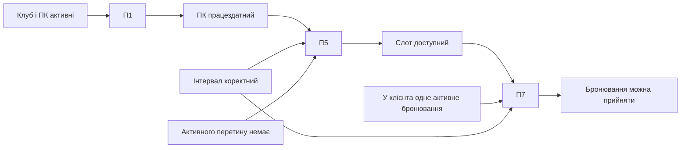
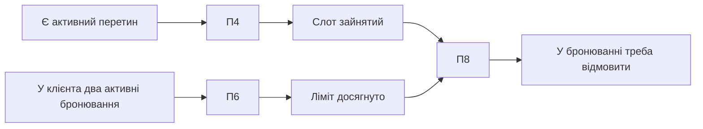
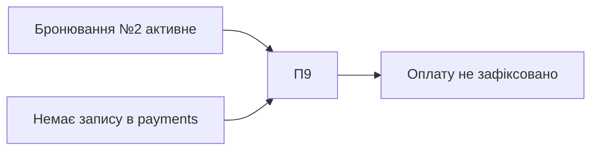
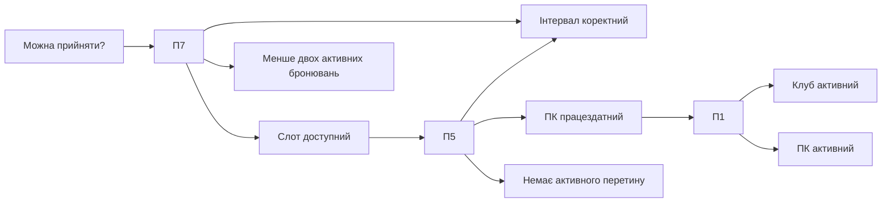

# База правил: бронювання в кіберклубі

Правила описують один запит на бронювання за раз. `client_under_limit` означає, що клієнт має менше двох активних (не скасованих) бронювань у перевірюваному наборі даних. Запит приймається лише тоді, коли клуб і ПК активні, інтервал коректний, активні бронювання цього ПК не перетинаються із запитом, а клієнт не досяг ліміту. Окреме правило П9 перевіряє оплату вибраного активного бронювання після його створення.

## 1. Продукційні правила

| Правило | ЯКЩО | ТО |
|---|---|---|
| П1 | Клуб активний **і** вибраний ПК активний. | ПК працездатний. |
| П2 | Вибраний ПК неактивний. | ПК недоступний. |
| П3 | Вибраний клуб неактивний. | Клуб недоступний. |
| П4 | Є активне бронювання вибраного ПК, інтервал якого перетинається із запитаним. | Запитаний слот зайнятий. |
| П5 | ПК працездатний, інтервал запиту коректний і активного перетину бронювань немає. | Слот доступний. |
| П6 | Клієнт має щонайменше два активні бронювання. | Клієнт досяг ліміту бронювань. |
| П7 | Слот доступний, інтервал коректний, а в клієнта менше двох активних бронювань. | Бронювання можна прийняти. |
| П8 | ПК або клуб недоступний, слот зайнятий чи клієнт досяг ліміту. | У бронюванні треба відмовити. |
| П9 | Вибране активне бронювання не має пов'язаного запису про оплату. | Оплату за бронювання не зафіксовано. |

Правила, що спираються на висновки інших правил: П5 (на П1), П7 (на П5), П8 (на П2, П3, П4 або П6).

Правила зі складеною умовою: П1, П5 і П7 використовують умову «і»; П8 спрацьовує, якщо істинна будь-яка з причин, з'єднаних «або».

Пара правил із протилежними висновками: П7 «бронювання можна прийняти» і П8 «у бронюванні треба відмовити». За повних фактів умови не перетинаються: П7 вимагає доступний слот і менше двох активних бронювань, а П8 — зайнятий слот, недоступний ресурс або досягнутий ліміт.

Правило П9 про оплату не змінює рішення П7/П8: у поточній моделі неоплачене бронювання можливе, автоматичної відмови через відсутність платежу немає.

## 2. Джерело кожної умови

| Правило | Умова | Джерело |
|---|---|---|
| П1 | Клуб активний | `clubs.is_active` |
| П1 | ПК активний | `pcs.is_active` |
| П2 | ПК неактивний | `pcs.is_active` |
| П3 | Клуб неактивний | `clubs.is_active` |
| П4 | Наявне бронювання активне | `reservations.status` |
| П4 | Інтервал наявного бронювання перетинається із запитом | `reservations.starts_at`, `reservations.ends_at`; запитаний інтервал вводить працівник бронювання |
| П5 | ПК працездатний | Висновок П1 |
| П5 | Інтервал запиту коректний | `reservations.starts_at`, `reservations.ends_at` для наявних рядків; новий інтервал вводить клієнт і перевіряє застосунок бронювання |
| П5 | Немає активного перетину | Пошук у `reservations` за `pc_id`, `status`, `starts_at` і `ends_at` |
| П6 | У клієнта щонайменше два активні бронювання | Підрахунок рядків у `reservations` за `client_id` і `status` |
| П7 | Слот доступний | Висновок П5 |
| П7 | Інтервал запиту коректний | Запит бронювання, введений клієнтом і перевірений застосунком |
| П7 | У клієнта менше двох активних бронювань | Підрахунок рядків у `reservations` за `client_id` і `status` |
| П8 | ПК недоступний | Висновок П2 |
| П8 | Клуб недоступний | Висновок П3 |
| П8 | Слот зайнятий | Висновок П4 |
| П8 | Клієнт досяг ліміту | Висновок П6 |
| П9 | Вибране активне бронювання не має запису про оплату | `reservations.status` і відсутність відповідного `reservation_id` у `payments` |

Схема не зберігає запит, який ще не вставлений у базу. Клієнт передає бажаний час початку й завершення, а застосунок бронювання перевіряє умову `ends_at > starts_at`. Перетин перевіряється за актуальними рядками під час прийняття рішення. Остаточним захистом від конкурентних конфліктних вставок залишається exclusion constraint у PostgreSQL.

Для П9 відсутність рядка в `payments` означає лише те, що оплату не зафіксовано в базі. Це не доводить, що клієнт відмовився платити або що настав строк оплати.

Правила, що спираються лише на початкові факти: П1, П2, П3, П4, П6 і П9 (6).
Правила, що використовують похідні висновки: П5, П7 і П8 (3).

## 3. Приклади прямого виведення

### Прогін 1: вільний ПК можна забронювати

Початкові факти:

| Факт | Значення |
|---|---|
| ф1 | Клуб активний. |
| ф2 | Вибраний ПК активний. |
| ф3 | Запитаний інтервал коректний. |
| ф4 | На цьому ПК немає активного бронювання, що перетинається із запитаним інтервалом. |
| ф5 | У клієнта одне активне бронювання. |
| ф6 | Клієнт підтвердив запит. |

Початковий конфліктний набір: П1.

| Цикл | Правило | Новий факт |
|---:|---|---|
| 1 | П1 | ф7: ПК працездатний. |
| 2 | П5 | ф8: слот доступний. |
| 3 | П7 | ф9: бронювання можна прийняти. |
| 4 | — | Нових фактів немає; досягнуто нерухомої точки. |

Спочатку було 6 фактів, у нерухомій точці — 9. Правила П2, П3, П4, П6 і П8 не спрацювали.

### Прогін 2: бронювання з перетином треба відхилити

Початкові факти:

| Факт | Значення |
|---|---|
| ф1 | Клуб активний. |
| ф2 | Вибраний ПК активний. |
| ф3 | Запитаний інтервал коректний. |
| ф4 | Є активне бронювання цього ПК, що перетинається із запитом. |
| ф5 | У клієнта вже є два активні бронювання. |
| ф6 | Клієнт підтвердив запит. |

Початковий конфліктний набір: П1, П4 і П6. Застосовуємо правила за номером.

| Цикл | Правило | Новий факт |
|---:|---|---|
| 1 | П1 | ф7: ПК працездатний. |
| 1 | П4 | ф8: слот зайнятий. |
| 1 | П6 | ф9: клієнт досяг ліміту. |
| 2 | П8 | ф10: у бронюванні треба відмовити. |
| 3 | — | Нових фактів немає; досягнуто нерухомої точки. |

Спочатку було 6 фактів, у нерухомій точці — 10. Правила П2, П3, П5 і П7 не спрацювали.

Правила залишилися тими самими; змінилися лише запит і факти бази даних. Правило не спрацьовує, якщо в конкретній ситуації відсутня його умова. Це проблема лише тоді, коли реальна ситуація мала б активувати правило, але потрібного факту або джерела немає.

### Прогін 3: активне бронювання без оплати

У бронювання №2 статус `active`, але пов'язаного запису в `payments` немає.

| Факт | Значення |
|---|---|
| ф1 | Бронювання №2 активне. |
| ф2 | Для бронювання №2 немає запису про оплату. |

Початковий конфліктний набір: П9.

| Цикл | Правило | Новий факт |
|---:|---|---|
| 1 | П9 | ф3: оплату за бронювання №2 не зафіксовано. |
| 2 | — | Нових фактів немає; досягнуто нерухомої точки. |

П9 виявляє неоплачене бронювання, але саме по собі не вимагає його відхилити. Це відповідає схемі: платежу може ще не бути. Правило перевіряє вже створене бронювання; у прогонах 1 і 2 розглядається ще не збережений запит.

## 4. Ланцюжки виведення

### Прогін 1

Висновок: бронювання можна прийняти.

Для замовника: «ПК працює, слот вільний, клієнт не досяг ліміту — бронювання можна прийняти».

### Прогін 2

Висновок: у бронюванні треба відмовити.

П1 також спрацювало, але не входить до ланцюжка відмови.

### Прогін 3

Висновок: оплату за бронювання №2 не зафіксовано.

## 5. Зворотне виведення

### Гіпотеза підтверджується

Гіпотеза: «бронювання можна прийняти» (П7). Для її доведення потрібні доступний слот, коректний інтервал і менше двох активних бронювань. Слот стає доступним за П5, а працездатність ПК підтверджує П1.

Не потрібні П2, П3, П4, П6, П8 і П9: вони не доводять гіпотезу прийняття.

### Гіпотеза не підтверджується

Для прогону 1 гіпотеза «слот зайнятий» не підтверджується: у фактах явно зазначено, що активного перетину немає.

Якщо у фактах взагалі немає відповіді про перетин, це означає «невідомо», а не «перетину точно немає». За припущенням замкнутого світу відсутність факту все одно може трактуватися як «ні», що небезпечно для бронювання.

## 6. Приклад журналу рішення

| Пункт | Запис |
|---|---|
| Рішення | Прийняти один запит на бронювання активного ПК. |
| Факти | ф1–ф6 із прогону 1. |
| Версія бази правил | `rules.md`, версія 2. |
| Пояснення | П1 підтверджує працездатність ПК; П5 — доступність слота; П7 дозволяє прийняти запит, бо в клієнта одне активне бронювання. |
| Підтвердження | Рішення підтверджує адміністратор бронювання клубу. |
